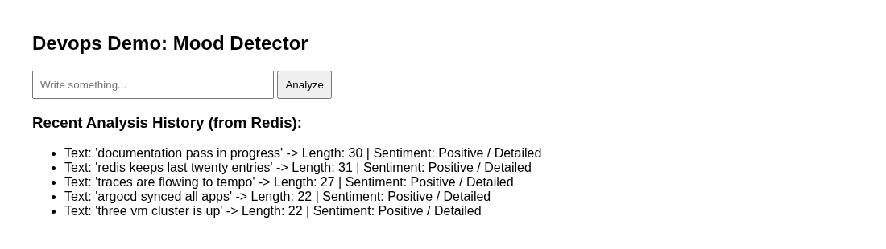

# mood-app

      

Кластер Kubernetes на трёх домашних виртуалках, приложение на нём и весь обвес вокруг: создание машин кодом, доставка через GitOps, мониторинг, трассировка, секреты.

Репозиторий собран как портфолио. Кластер живёт на моём домашнем сервере, зайти туда снаружи нельзя, поэтому весь стенд описан кодом и проверяется командами ниже.



## Что умеет приложение

Пользователь вводит фразу, аналитика считает длину и выдаёт настроение по простому правилу: длинный текст считается позитивным, короткий нейтральным. Результат показывается на странице, история последних запросов лежит в Redis.

Приложение намеренно маленькое: два сервиса на Python и Redis. Смысл репозитория не в нём, а в том, как оно собирается, доставляется и наблюдается.

## Стек

| Технология | Что делает | Почему она |
|---|---|---|
| Proxmox VE 9 | виртуализация | домашний сервер, есть API, платить не нужно |
| Terraform | создаёт виртуалки | кластер воспроизводится одной командой |
| cloud-init | первичная настройка машин | k3s ставится сам при первом старте, руками в ВМ я не захожу |
| k3s 1.36 | Kubernetes | один бинарник, для трёх узлов и 12 ГБ памяти хватает |
| ArgoCD | доставка | приложения едут из репозитория, кластер сам выравнивает себя к нему |
| Helm | шаблоны | приложение и системные компоненты описаны чартами |
| Sealed Secrets | секреты | пароли лежат в Git зашифрованными и расшифровываются только в кластере |
| kube-prometheus | мониторинг | Prometheus, Grafana и Alertmanager одним чартом |
| OpenTelemetry + Tempo | трассировка | видно путь запроса между сервисами |
| cert-manager | сертификаты | выдаёт самоподписанный сертификат для ingress |
| GitHub Actions | CI | собирает образы и обновляет теги в values.yaml |

## Как всё устроено

```
        ноутбук
           │   https://mood.local, https://grafana.mood.local
           │   имена прописаны в /etc/hosts на адрес 192.168.3.151
           ▼
  ┌─────────────────────────────────────────────┐
  │  Proxmox VE 9, узел proxmox, 192.168.3.100  │
  │                                             │
  │   mood-k3s-control    192.168.3.151   4 ГБ  │
  │   mood-k3s-worker1    192.168.3.152   3 ГБ  │
  │   mood-k3s-worker2    192.168.3.153   5 ГБ  │
  └────────────────────┬────────────────────────┘
                       │  кластер k3s, Traefik отвечает на всех трёх
                       ▼
  ┌─────────────────────────────────────────────┐
  │  ArgoCD смотрит в этот репозиторий          │
  │    ├── mood-app      фронтенд, аналитика,   │
  │    │                 Redis, HPA, ingress    │
  │    ├── monitoring    Prometheus, Grafana,   │
  │    │                 Alertmanager           │
  │    ├── tracing       оператор OTel и Tempo  │
  │    ├── secrets       Sealed Secrets         │
  │    └── certificates  cert-manager           │
  └─────────────────────────────────────────────┘
```

Доступа из интернета к кластеру нет. Сертификаты самоподписанные, поэтому браузер на них ругается, это ожидаемо. Алерты настроены на Telegram.

## Что ArgoCD завозит в кластер

Точкой входа служит `deploy/system/argocd/root-app.yaml`. Это app-of-apps: один манифест, который создаёт остальные приложения из папки `deploy/system/argocd/apps`. Дальше новые манифесты приезжают в кластер пушем в репозиторий, kubectl для них не нужен.

| Приложение ArgoCD | Что разворачивает |
|---|---|
| root-platform-app | остальные приложения из папки apps |
| app-platform | namespace `default` |
| app-sealed-secrets | контроллер Sealed Secrets |
| app-cert-manager | cert-manager |
| app-otel-operator | оператор OpenTelemetry |
| app-tempo | Tempo для хранения трасс |
| app-kube-prometheus | Prometheus, Grafana, Alertmanager, node-exporter |
| app-monitoring | ingress, issuer, AlertmanagerConfig, ServiceMonitor, Instrumentation |
| local-secrets | зашифрованные секреты (Redis, Grafana, бот Telegram) |
| mood-app | само приложение |

Всего десять приложений. Адреса Helm-репозиториев заведены отдельными Secret в той же папке.

## Как поднять с нуля

Порядок важен, потому что некоторые вещи ArgoCD развозит параллельно, а зависимости между ними есть.

1. Подготовить Proxmox. Нужны API-токен с правами на создание ВМ и загрузку файлов, хранилище с включёнными snippets и Ubuntu cloud-образ. У меня всё это на узле с адресом 192.168.3.100.

2. Создать виртуалки. Диски живут на NVMe, образы и бэкапы на отдельном HDD.

```
cd terraform/proxmox
cp terraform.tfvars.example terraform.tfvars
export PROXMOX_VE_ENDPOINT="https://192.168.3.100:8006/"
export PROXMOX_VE_API_TOKEN="terraform-prov@pve!terraform-token=..."
terraform init
terraform apply
```

Через пару минут появятся три машины. k3s на них ставится сам через cloud-init, первая нода поднимается сервером, две другие приходят к ней агентами.

3. Снять kubeconfig с control-узла и заменить в нём адрес на 192.168.3.151.

```
ssh ubuntu@192.168.3.151 'sudo cat /etc/rancher/k3s/k3s.yaml' > ~/.kube/config-mood-k3s
```

4. Поставить ArgoCD. CRD для ApplicationSet приходится применять отдельно и с флагом server-side, иначе манифест не проходит по размеру. Про эту ошибку ниже.

```
kubectl create namespace argocd
kubectl apply -n argocd -f https://raw.githubusercontent.com/argoproj/argo-cd/stable/manifests/install.yaml
kubectl apply --server-side=true -f https://raw.githubusercontent.com/argoproj/argo-cd/stable/manifests/crds/applicationset-crd.yaml
```

5. Положить в ArgoCD SSH-ключ от репозитория. Секрет называется `platform-repo-secret`, в Git он не лежит по понятным причинам.

6. Восстановить мастер-ключ Sealed Secrets в namespace `kube-system`. Без него ни один зашифрованный секрет не расшифруется, а ошибка выглядит как обычный сбой синхронизации. Ключ снимается один раз при первом развёртывании и хранится вне репозитория.

```
kubectl apply -f sealed-secrets-key-backup.yaml
```

7. Запустить app-of-apps и дождаться, пока всё съедется.

```
kubectl apply -f deploy/system/argocd/root-app.yaml
kubectl -n argocd get applications
```

8. Прописать имена на рабочей машине. Имена заканчиваются на `.local`, и это отдельная история, о ней в разделе с ошибками.

```
192.168.3.151 mood.local grafana.mood.local alertmanager.mood.local
```

## Что проверено на живом кластере

```
kubectl get nodes                      три узла Ready, k3s 1.36.5
kubectl -n argocd get applications     десять приложений, все Synced и Healthy
kubectl top nodes                      control 55% памяти, воркеры 51% и 30%
curl -H 'Host: mood.local' https://192.168.3.151/    200, и так на каждом узле
```

Трассировка проверена на настоящем запросе. `POST /submit` даёт одну трассу из одиннадцати спанов: семь у mood-frontend, четыре у mood-analytics. Видны обращения к Redis и переход между сервисами.

## Ошибки, на которые я наступил

Собрал здесь то, что стоило времени, вместе с причиной.

Статический адрес применился только к одной машине из трёх. Остальные две не отвечали по SSH. Причина в имени интерфейса: Proxmox создаёт его как `eth0`, а Ubuntu переименовывает в `ens18`, поэтому конфиг сети из cloud-init просто не находил интерфейс. Починил отдельным netplan-файлом, который цепляется к сетевой карте по MAC-адресу.

SSH-ключ не доезжал до машин. Proxmox умеет добавлять ключ сам, но только к своему варианту user-data, а свой конфиг полностью его заменяет. Пришлось прописать `ssh_authorized_keys` внутри cloud-init.

API кластера отвечал таймаутом при живом железе. Control plane стоял на 2 ГБ памяти, k3s занял её всю. Поднял до 4 ГБ. Отдельная тонкость: провайдер Proxmox не меняет память работающей машине, для этого нужен `reboot_after_update = true`.

CRD ApplicationSet не создавался вообще. Манифест весит больше 256 КБ, а клиентский `kubectl apply` такие объекты не пропускает и падает на аннотации. Спасает `--server-side=true`.

Агента трассировки не было в подах приложения. Приложение работало, трасс в Tempo не было ни одной. Поды стартовали раньше, чем ArgoCD создал объект Instrumentation, а оператор правит только новые поды. Помог перезапуск деплоймента. Правильнее разводить их по волнам синхронизации, но это я ещё не сделал.

Имена на `.local` не резолвились. Прошёл весь путь от hosts до nsswitch: в `mdns_minimal [NOTFOUND=return]` стоит остановка поиска, и любой запрос на `.local` уходит в multicast DNS, до файла hosts дело не доходит. Сейчас там порядок с `files` впереди, но по-хорошему от `.local` надо уходить, стандарт отдаёт этот домен под локальное обнаружение.

## Что можно улучшить

Control plane один. Для домашнего стенда это компромисс: упавший узел роняет API, кворума нет.

Версии не закреплены. ArgoCD и чарты ставятся по `latest` и `stable`, при переустановке приедет непонятно что. Теги стоит зафиксировать.

Образы тянутся с Docker Hub. Для приватного реестра нужен imagePullSecret, я это не делал.

История короткая. Prometheus хранит метрики десять дней, Tempo трассы трое суток. Для длинного хранения нужен внешний объектный бакет.

Проверки здоровья пишутся в трассы наравне с рабочими запросами, шума много. Фильтр не настроен.

Мелочи: chatID бота Telegram лежит в манифесте, его место в Secret. В CI адрес бота написан с опечаткой, руки не дошли. Файл `coredns-lan.yaml` остался с тех времён, когда VPN на ноутбуке перехватывал DNS внутри кластера, сейчас его можно убрать.

## Структура репозитория

```
apps/
  frontend/            FastAPI, страница, история из Redis, вызов аналитики
  analytics/           FastAPI, длина текста и настроение
deploy/
  mood-app/            Helm-чарт приложения, включая HPA и NetworkPolicy
  system/
    argocd/            root-app.yaml и манифесты десяти приложений
    helm/              values для cert-manager, Tempo, оператора OTel, Sealed Secrets
    kube-prometheus/   values для стека мониторинга
    monitoring/        ingress, issuer, AlertmanagerConfig, ServiceMonitor, Instrumentation
    platform/          namespace и coredns-lan
    secrets/           зашифрованные пароли
docs/                  скриншот приложения
terraform/proxmox/     создание трёх виртуалок и установка k3s через cloud-init
.github/workflows/     сборка образов и обновление тегов
```

## Почему Proxmox

Стенд начинался в Yandex Cloud и пережил там аварию дата-центра. В VK Cloud упёрся в квоты: ноль плавающих адресов, ноль балансировщиков, ноль портов во внешней сети. Тогда я поднял Proxmox на домашнем железе и перенёс кластер туда.

Код для обоих облаков остался в истории коммитов, в актуальной ветке лежит только Proxmox.
