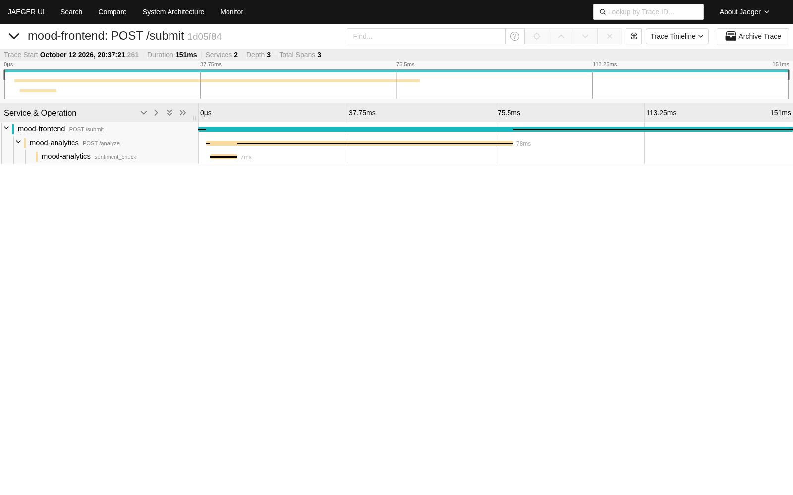

# Mood Detector - учебный DevOps-проект

Мой pet-проект, на котором я учился DevOps.

---

## Что делает приложение

Маленький сайт-"Определитель настроения":

1. Ты вводишь текст в форму.
2. Он уходит во второй сервис (analytics), который считает длину текста и выдаёт "настроение".
3. Результат сохраняется в **Redis**, чтобы показывать историю последних запросов.
4. Есть страница `/metrics`, откуда **Prometheus** забирает цифры (сколько запросов, сколько по времени).

Логика "настроения" - чем длиннее текст, тем "позитивнее".

---

## Из чего состоит

| Часть | Что это | Зачем |
|---|---|---|
| `apps/frontend` | Python + FastAPI | сайт с формой, отдаёт `/metrics` |
| `apps/analytics` | Python + FastAPI | считает результат по тексту |
| `redis` | база в памяти | хранит историю последних 20 запросов |
| `docker-compose.yml` | локальный запуск | чтобы посмотреть приложение на своём компьютере |
| `deploy/mood-app` | Helm-чарт | описание приложения для Kubernetes |
| `deploy/system/argocd/root-app.yaml` | **точка входа в кластер** | применяешь его один раз - ArgoCD поднимает всё остальное |
| `deploy/system` | манифесты инфраструктуры | ArgoCD, мониторинг, секреты |

---

## Технологии (и зачем они тут)

- **Docker** - упаковываю приложение в образ, чтобы оно одинаково работало везде.
  Образы собираются через `multi-stage` и на **distroless** от гугл.
- **Docker Compose** - запуск всех сервисов локально одной командой.
- **Kubernetes (k3s)** - кластер, который сам следит, чтобы приложения работали, перезапускает
  упавшие, распределяет нагрузку.
- **Helm** - шаблоны для Kubernetes.
- **GitHub Actions** - CI/CD. При пуше кода бот собирает образы, отправляет их в Docker Hub
  и обновляет версии в Helm-чарте.
- **ArgoCD** - GitOps. Следит за этим репозиторием и сам применяет изменения в кластере.
- **Traefik** - вход в кластер (ingress). Принимает запросы снаружи и решает, куда их отправить.
- **cert-manager** - сам выпускает TLS-сертификаты, чтобы было HTTPS.
- **Prometheus + Grafana** (kube-prometheus-stack) - сбор и показ метрик.
- **Jaeger** - трассировка: показывает путь одного запроса через все сервисы и где он тормозит.
- **External Secrets / Sealed Secrets** - секреты (пароли) не лежат в git открытым текстом.
- **HPA** - автомасштабирование: если нагрузка растёт, Kubernetes добавляет копии приложения.

---

## Как это устроено

```
   я пишу код
       │  git push
       ▼
 GitHub Actions ──► собирает образы ──► Docker Hub
       │                                  │
       │ обновляет версию в Helm-чарте     │
       ▼                                  │
   git-репозиторий                        │
       │                                  │
       │ ArgoCD видит изменения           │
       ▼                                  ▼
 ┌───────────────────── Kubernetes (k3s) ─────────────────────┐
 │                                                            │
 │   Traefik (вход) ──► frontend ──► analytics                │
 │        ▲                  │                                │
 │        │ HTTPS            ▼                                │
 │   cert-manager          Redis                              │
 │                                                            │
 │   Prometheus ◄── /metrics      Jaeger ◄── трассировка      │
 └────────────────────────────────────────────────────────────┘
```

Коротко весь путь: **код > сборка > образ > GitOps > кластер**.

---

## Как это поднимается

### Локально (просто посмотреть приложение)

Docker Compose нужен только для локальной разработки, в кластере он не используется.

```bash
# 1. создай .env рядом с docker-compose.yml
echo "REDIS_PASSWORD=мой_пароль" > .env

# 2. подними всё
docker compose up --build
```

Сайт: http://localhost:8000 · аналитика: http://localhost:8001/healthz

### В кластер: одна команда

Точка входа в кластер - **`deploy/system/argocd/root-app.yaml`**. С него всё начинается:

```bash
kubectl apply -f deploy/system/argocd/root-app.yaml
```

Дальше работает сам:

```
root-app.yaml
     │ создаёт в ArgoCD одно корневое приложение
     ▼
root-platform-app
     │ смотрит на папку deploy/system/argocd/apps
     │ и создаёт оттуда четыре дочерних приложения
     ▼
┌──────────────────────┬───────────────────────┐
│ mood-app             │ cloud-secrets         │
│ (deploy/mood-app)    │ (external-secrets)    │
│ само приложение      │ секреты               │
├──────────────────────┼───────────────────────┤
│ app-monitoring       │ jaeger-operator       │
│ (deploy/system/...)  │ (публичный helm-чарт) │
│ метрики, TLS, Jaeger │ сам оператор Jaeger   │
└──────────────────────┴───────────────────────┘
```

Это паттерн **app-of-apps**: одно приложение создаёт остальные. Поэтому руками в кластер
ничего применять не нужно - коммит в git, и ArgoCD сам приводит кластер к нужному виду
(включены `auto-sync`, `selfHeal` и `prune`).

Проверить, что поднялось:

```bash
kubectl get applications -n argocd
```

Что должно быть **заранее** (ставится отдельно, не этим репозиторием): k3s, ArgoCD,
Traefik, cert-manager, kube-prometheus-stack, External Secrets и Sealed Secrets.

А вот **оператор Jaeger ставить руками не нужно** - он тоже разворачивается из этого репозитория:
приложение `jaeger-operator` берёт helm-чарт из публичного репозитория Jaeger и включает ему флаг
`rbac.clusterRole=true`. Без этого флага оператор не видит объекты в других namespace, и Jaeger
не поднимается - именно на этом я спотыкался.

---

## Что я настроил сам (по пунктам)

- Разделил проект на два сервиса и связал их по HTTP.
- Собрал безопасные Docker-образы: multi-stage + distroless + rootless.
- Добавил health-check'и, чтобы Kubernetes понимал, когда приложение живое
  (liveness/readiness probes), и не слал трафик в мёртвый под.
- Описал приложение в Helm-чарте.
- Настроил CI/CD: сборка образов и автоподстановка новых версий в чарт.
- Настроил GitOps через ArgoCD. Точка входа `deploy/system/argocd/root-app.yaml`: применяешь его один раз, и корневое приложение создаёт остальные (app-of-apps).
- Подключил HTTPS с автоматическими сертификатами и редиректом с HTTP.
- Настроил сбор метрик (свои счётчики в коде)
- Настроил секреты: External Secrets из Yandex Cloud Lockbox + Sealed Secrets.
- Добавил HPA (автомасштабирование) и NetworkPolicy (какие сервисы видят друг друга).
- Развернул трассировку Jaeger: и сам оператор Jaeger, и Jaeger управляются из git через ArgoCD
  (helm-чарт + флаг `rbac.clusterRole=true`), а не ставятся руками.

---

## Скриншот: трассировка в Jaeger

Так Jaeger показывает путь запроса по сервисам и сколько времени ушло на каждый шаг -
видно, как `mood-frontend` вызывает `mood-analytics` (здесь весь запрос занял 151 мс):



---

## Что можно улучшить

- Jaeger сейчас в режиме `allInOne` с хранением в памяти - трейсы пропадают при перезапуске.
  Для правильного варианта нужно внешнее хранилище.
- Приложения пока не отправляют трейсы автоматически - нужно добавить OpenTelemetry.
- Образы пока в публичном Docker Hub; можно перейти на yandex container registry со сканированием уязвимостей.
- Добавить тесты и проверку кода в CI.
- Алерты в Alertmanager.

---

## Структура репозитория

```
platform/
├── apps/
│   ├── frontend/
│   │   ├── app.py                     # сайт: форма, /metrics, история в Redis
│   │   ├── Dockerfile                 # multi-stage + distroless
│   │   └── requirements.txt
│   └── analytics/
│       ├── app.py                     # POST /analyze, GET /healthz
│       ├── Dockerfile
│       └── requirements.txt
│
├── deploy/
│   ├── mood-app/                      # Helm-чарт приложения
│   │   ├── Chart.yaml
│   │   ├── values.yaml                # версии образов (их обновляет CI/CD)
│   │   ├── .helmignore
│   │   └── templates/
│   │       ├── frontend.yaml          # Deployment + Service
│   │       ├── analytics.yaml
│   │       ├── redis.yaml
│   │       ├── ingress.yaml           # HTTPS + редирект с http
│   │       ├── middleware-ratelimit.yaml
│   │       ├── hpa-frontend.yaml      # автомасштабирование
│   │       ├── hpa-analytics.yaml
│   │       ├── network-policy-analytics.yaml   # кто кого видит
│   │       └── network-policy-redis.yaml
│   │
│   └── system/
│       ├── argocd/
│       │   ├── root-app.yaml          # ← ТОЧКА ВХОДА В КЛАСТЕР
│       │   └── apps/
│       │       ├── app-mood.yaml       # приложение
│       │       ├── app-secrets.yaml    # секреты
│       │       ├── app-monitoring.yaml # метрики, TLS, Jaeger
│       │       └── app-jaeger-operator.yaml  # оператор Jaeger (публичный helm-чарт)
│       ├── monitoring/
│       │   ├── service-monitor.yaml   # Prometheus забирает /metrics
│       │   ├── issuer.yaml            # самоподписанный центр сертификатов
│       │   └── jaeger.yaml            # трассировка
│       └── external-secrets/
│           ├── secret-store.yaml      # подключение к Yandex Cloud Lockbox
│           ├── external-secret.yaml   # тянет пароль Redis
│           └── yc-sealed-secret.yaml  # доступ к облаку
│
├── docs/
│   └── jaeger-ui.png                  # скриншот Jaeger
│
├── .github/workflows/
│   └── ci-cd.yml                      # сборка образов + обновление версий
│
├── docker-compose.yml                 # локальный запуск
├── .env                               # пароль локально (в .gitignore)
├── .gitignore
└── README.md
```